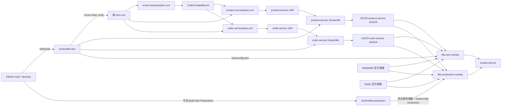
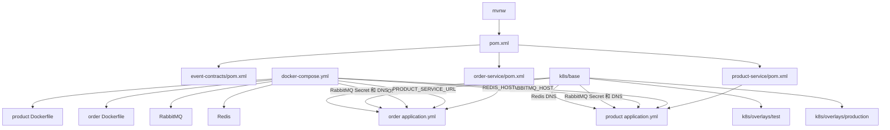
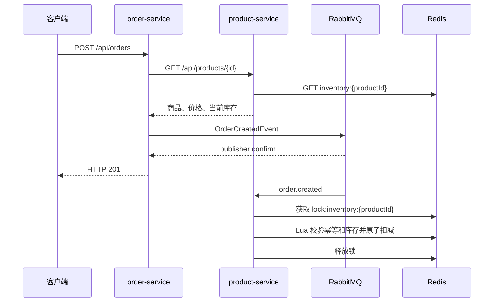
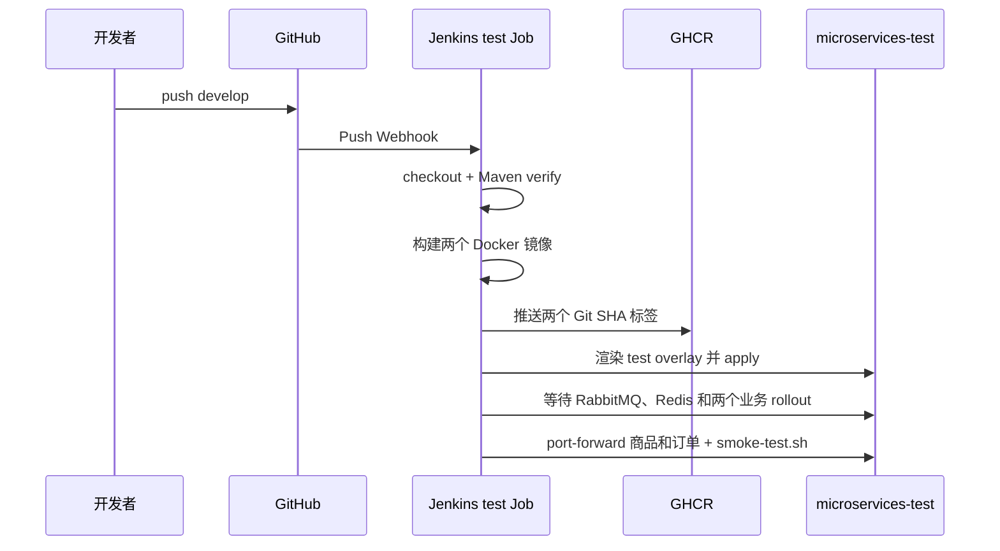
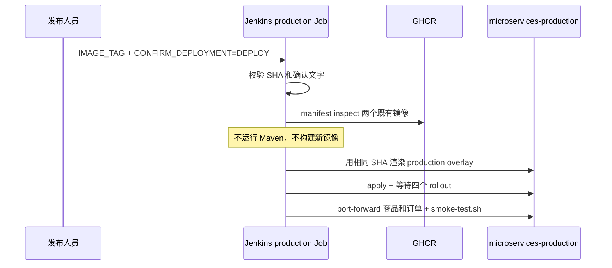

# 配置文件调用关系

本文只解释“谁调用谁”和业务链路。具体执行命令、凭证和故障排查见根目录
`README.md`。

## 从源码到运行环境



GHCR 只是业务镜像仓库：Jenkins 把两个已测试的业务镜像推到这里，Kubernetes 再
按 Git SHA 拉取。RabbitMQ 和 Redis 直接使用官方镜像，不经过本项目重新构建。

## 本地和集群配置调用链



本地直接运行时依赖地址是 `localhost`；Compose 和 Kubernetes 内部通过 Service
名使用 `product-service:8081`、`rabbitmq:5672` 和 `redis:6379`。应用只读取环境
变量，不需要知道自己运行在 Compose 还是 Kubernetes。

## 下单与扣库存的业务时序



RabbitMQ 负责传递，不负责扣库存；Redisson 锁让同一商品串行处理；Lua 脚本保证
“扣库存 + 写幂等标记”不可分割。相同消息再次投递时，
`processed-order:{orderId}` 使它直接返回，不会重复扣减。

## 每个配置文件由谁调用

| 文件 | 调用者 | 作用 |
| --- | --- | --- |
| 根 `pom.xml` | `mvnw`、Jenkins | 按顺序构建契约、商品、订单模块 |
| 各模块 `pom.xml` | Maven | 声明模块自己的编译和运行依赖 |
| `application.yml` | Spring Boot 启动过程 | 把环境变量转换为 HTTP、RabbitMQ、Redis、锁配置 |
| 两个 `Dockerfile` | `docker build`、Jenkins | 只把 Maven 已生成的 JAR 封装成业务镜像 |
| `docker-compose.yml` | `docker compose` | 本地启动和连接 RabbitMQ、Redis、两个业务容器 |
| `k8s/base/*.yml` | Kustomize | 定义四个工作负载、Service、探针、资源和教学 Secret |
| `k8s/overlays/*` | Kustomize、Jenkins | 叠加 namespace、业务副本数和镜像标签 |
| `Jenkinsfile.test` | develop Job / GitHub Webhook | 测试、构建、推送 GHCR、部署测试环境、冒烟 |
| `Jenkinsfile.production` | 发布人员手动点击 | 校验既有 SHA 镜像，部署生产环境，不重新构建 |
| `scripts/smoke-test.sh` | 人工或 Jenkins | 下单前后查询商品，断言库存精确减少 2 |

## 自动测试环境时序



任何一步失败，后续阶段不会继续；失败提交不会成为可晋级的测试制品。

## 手动生产环境时序



## 凭证、DLQ 与生产边界

| 凭证 ID | 读取者 | 用途 | 不应出现的位置 |
| --- | --- | --- | --- |
| `github-container-registry` | 两份 Jenkinsfile | 登录 GHCR、推送或检查镜像 | Git、日志明文、Dockerfile |
| `kubeconfig-test` | `Jenkinsfile.test` | 部署测试 namespace | 生产 Job、Git |
| `kubeconfig-production` | `Jenkinsfile.production` | 部署生产 namespace | 测试 Job、Git |
| `ghcr-pull-secret` | Kubernetes Deployment | Pod 从 GHCR 拉取镜像 | 仓库中的明文 Secret YAML |
| `rabbitmq-credentials` | 业务 Pod、RabbitMQ | 教学环境消息账号 | 真实生产密码 |

库存不足或商品不存在时，消息进入 `inventory.order-created.dlq`。本地可在 RabbitMQ
管理页面 <http://localhost:15672> 查看主队列、重试和 DLQ，也可检查 Redis：

```bash
docker compose exec redis redis-cli GET inventory:1
docker compose exec redis redis-cli KEYS 'processed-order:*'
```

本项目的 RabbitMQ、Redis 是单副本、无持久卷的教学配置。Kubernetes 会维持 Pod、
Service DNS、探针、滚动更新和故障重启，但不会自动把单机中间件变成生产级高可用，
也不会替代数据备份、失败补偿、监控告警或外部 Secret 管理。
