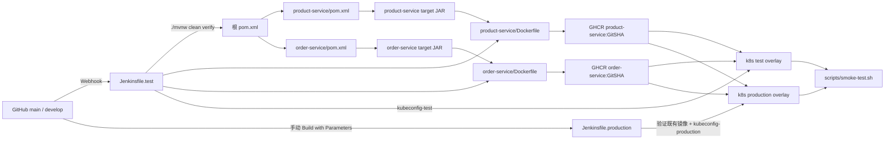
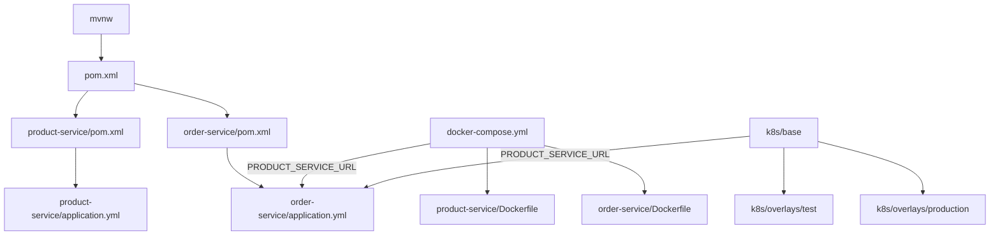
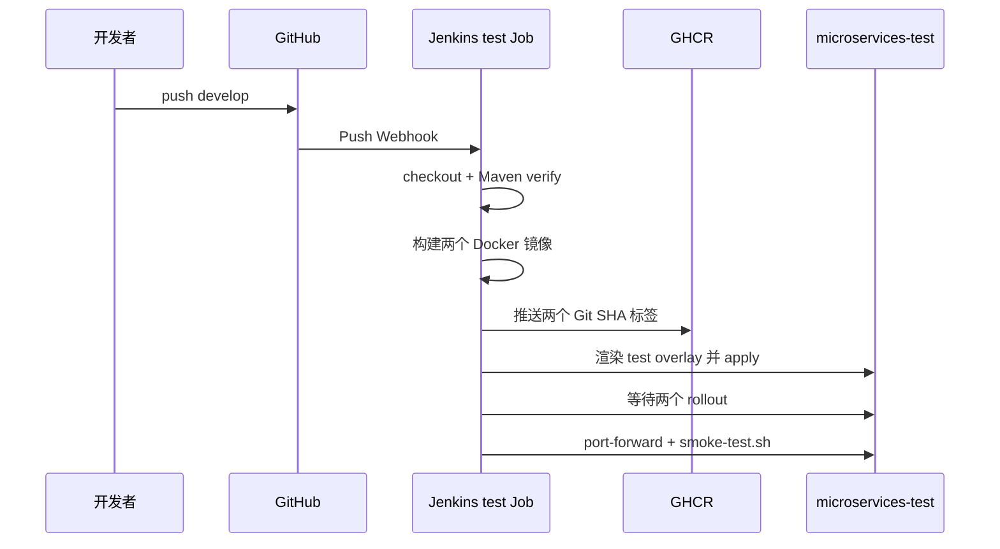
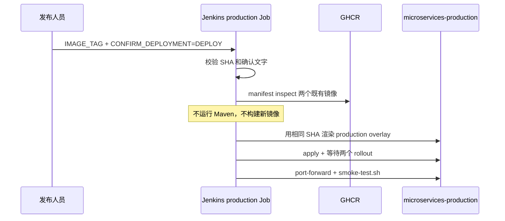

# 配置文件调用关系

本文只解释“谁调用谁”。具体命令和凭证配置见根目录 `README.md`。

## 从源码到运行环境

## 本地配置调用链

关键边界只有一个：订单服务从 `PRODUCT_SERVICE_URL` 读取产品服务地址。本地
直接运行时是 `localhost:8081`；Compose 和 Kubernetes 内部都是
`product-service:8081`。

## 自动测试环境时序

任何一步失败，后续阶段不会继续；失败提交不会进入测试环境的“已验证制品”集合。

## 手动生产环境时序

## 凭证在哪里生效

| 凭证 ID | 读取者 | 用途 | 不应出现的位置 |
| --- | --- | --- | --- |
| `github-container-registry` | 两份 Jenkinsfile | 登录 GHCR、推送或检查镜像 | Git、日志明文、Dockerfile |
| `kubeconfig-test` | `Jenkinsfile.test` | 部署测试 namespace | 生产 Job、Git |
| `kubeconfig-production` | `Jenkinsfile.production` | 部署生产 namespace | 测试 Job、Git |
| `ghcr-pull-secret` | Kubernetes Deployment | Pod 从 GHCR 拉取镜像 | 仓库中的明文 Secret YAML |

Jenkins 的 file/usernamePassword binding 只在对应步骤临时注入；Kubernetes Secret
在集群中预先创建。仓库保存的是凭证名称和调用关系，不保存凭证值。
